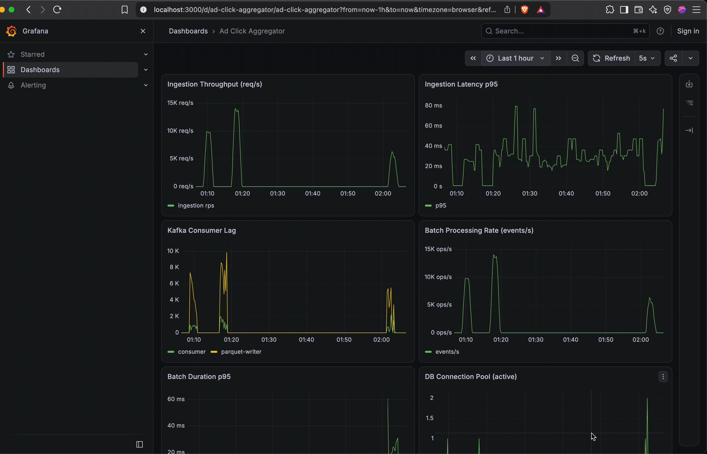

# Ad Click Aggregator

Multi-module Spring Boot project for ad click aggregation with Kafka and PostgreSQL.

## Project Structure

```
ad-click-aggregator/
├── ingestion-service/     # Ingestion service (port 8080)
├── consumer-service/      # Consumer service (port 8081)
├── parquet-service/       # Parquet writer service (port 8082)
├── docker-compose.yml     # Docker orchestration
└── pom.xml               # Parent POM
```

## Services

- **Ingestion Service**: Runs on port 8080, produces messages to Kafka
- **Consumer Service**: Runs on port 8081, consumes from Kafka and writes to PostgreSQL
- **Parquet Service**: Runs on port 8082, a second consumer group (`parquet-writer`) on the same `ingestion` topic that writes Parquet files for DuckDB (see below)
- **PostgreSQL**: Database on port 5432
- **Kafka**: Message broker on port 9092

## Analytics with DuckDB (Parquet)

`consumer-service` and `parquet-service` use different consumer group ids (`consumer` and `parquet-writer`), so each receives every message on the `ingestion` topic and tracks its own offsets. The Parquet service writes to `./data/parquet` (bind-mounted from the container), laid out as Hive partitions by event date (UTC):

```
data/parquet/dt=2026-11-19/part-<epoch-ms>-<batch-uuid>.parquet
```

Each file is zstd-compressed with rows sorted by `time`. Files are written under a `.tmp` name and renamed when complete, so always glob `*.parquet`. Query them from any DuckDB:

```sql
SELECT service, level, count(*)
FROM read_parquet('data/parquet/dt=*/*.parquet', hive_partitioning = true)
WHERE dt >= current_date - 7
GROUP BY ALL;
```

Notes:

- **Delivery is at-least-once.** Offsets are committed only after the files are on disk, so a crash can write a batch twice. `ingestion-service` does not emit a `uuid` yet, so there is no de-duplication key today.
- **One file per Kafka poll per event date.** Under load the polls are large (up to 5000 records); at low traffic you get many small files. DuckDB handles that fine, but a periodic compaction job would be a good follow-up.
- **Malformed messages** go to the `ingestion-parquet-dlt` topic. If the disk is unavailable the service retries the same batch with backoff rather than dropping data.
- **Backfill:** a new group starts from the earliest offset still retained in Kafka.
- **Building behind a TLS-intercepting proxy:** `docker compose build --build-arg MAVEN_EXTRA_ARGS="-Daether.connector.https.securityMode=insecure" parquet-service`
- Config is in `parquet-service/src/main/resources/application.yaml` (`PARQUET_OUTPUT_DIR`, `PARQUET_COMPRESSION`, `SPRING_KAFKA_PARQUET_CONCURRENCY`, ...).

## Performance



Load tested with k6 (`loadtest/ingestion.js`, constant arrival rate, `POST /api/v1/logs/`) from a separate machine.

**10,000 requests/s for 120 seconds (target 1.2M requests):**


| Metric                                   | Result              |
| ---------------------------------------- | ------------------- |
| Requests completed                       | 1,179,481 (~9.8k/s) |
| Successful (2xx)                         | 1,177,117           |
| Failed                                   | 2,364 (~0.2%)       |
| Latency p95                              | 40.9 ms             |
| Not started by the load generator        | ~20.5k (~1.7%)      |
| Thresholds (failures < 1%, p95 < 500 ms) | Passed              |


Scope of this result:

- Latency is the time for the ingestion API to accept a request. It does not include delivery to Kafka or availability in Parquet, which were not measured.
- To reproduce: `RATE=10000 DURATION=120s`, with `URL` pointing at the ingestion service.

## Getting Started

### Prerequisites

- Docker and Docker Compose
- Java 25
- Maven 3.9+

### Running the Application

1. **Start all services** (infrastructure + both Spring Boot apps):
  ```bash
   docker-compose up --build
  ```
2. **Start only infrastructure** (if you want to run Spring Boot apps locally):
  ```bash
   docker-compose up postgres kafka
  ```
3. **Build the project locally**:
  ```bash
   mvn clean install
  ```
4. **Run individual services locally** (from project root):
  ```bash
   # Terminal 1 - Ingestion Service
   cd ingestion-service && mvn spring-boot:run

   # Terminal 2 - Consumer Service
   cd consumer-service && mvn spring-boot:run
  ```

### Accessing Services

- Ingestion Service: [http://localhost:8080](http://localhost:8080)
- Consumer Service: [http://localhost:8081](http://localhost:8081)
- PostgreSQL: localhost:5432
- Kafka: localhost:9092

### Stopping Services

```bash
docker-compose down
```

To remove volumes as well:

```bash
docker-compose down -v
```

## Development Workflow

1. Code changes are made locally in your IDE
2. Both services run in Docker containers
3. Rebuild containers when needed: `docker-compose up --build`
4. View logs: `docker-compose logs -f [service-name]`

## Environment Variables

Both services support environment variable overrides:

- `SPRING_KAFKA_BOOTSTRAP_SERVERS` (default: localhost:9092)
- `SPRING_DATASOURCE_URL` (default: jdbc:postgresql://localhost:5432/postgres)
- `SPRING_DATASOURCE_USERNAME` (default: postgres)
- `SPRING_DATASOURCE_PASSWORD` (default: postgres)

